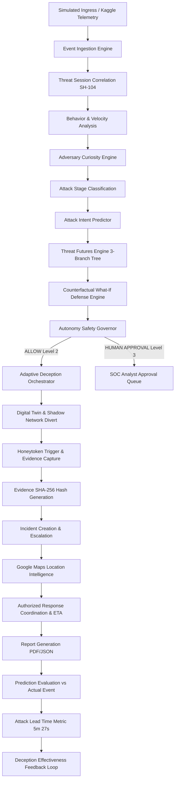

# SmartHive AI — System Architecture Document

## 1. High-Level Architecture Overview

SmartHive AI operates as a multi-tier, modular defensive cybersecurity platform structured into four core layers:

```
┌────────────────────────────────────────────────────────┐
│                   FRONTEND (CLIENT)                    │
│   React 18 + TypeScript + Vite + Tailwind CSS          │
│   React Flow (Graphs) + Recharts + Google Maps JS API  │
│   Socket.IO Client + Lucide React + Enterprise UI      │
└───────────────────────────▲────────────────────────────┘
                            │ HTTP REST / WebSocket JSON
┌───────────────────────────▼────────────────────────────┐
│              BACKEND ORCHESTRATION LAYER               │
│   Node.js + TypeScript + Express + Socket.IO           │
│   Modular Engines:                                     │
│   • Telemetry & Ingestion     • Curiosity Engine       │
│   • Threat Session Manager    • Threat Futures         │
│   • Risk & Behavior Engine    • Counterfactual Engine  │
│   • Safety Governor           • Deception Orchestrator │
│   • Evidence & Hashes (SHA256)• Incident Coordinator   │
│   • Response & Routing        • Report Generator       │
│   • Simulation Controller     • AI Investigator        │
└───────────────▲───────────────────────────▲────────────┘
                │ Prisma ORM                │ Internal HTTP REST
┌───────────────▼──────────┐    ┌───────────▼────────────┐
│      PERSISTENCE         │    │       AI ENGINE        │
│   PostgreSQL / SQLite    │    │   Python 3 + FastAPI   │
│   Prisma Client          │    │   scikit-learn, NumPy  │
│   26 Relational Models   │    │   Pandas, Joblib       │
│   Real-time Transcations │    │   Anomaly & ML Models  │
└──────────────────────────┘    └───────────▲────────────┘
                                            │ Kaggle Telemetry
                                ┌───────────┴────────────┐
                                │   REAL DATASET STORE   │
                                │   CUIP-X25 & AWS Honey │
                                │   Honeypot Telemetry   │
                                └────────────────────────┘
```

> [!IMPORTANT]
> **Strict Security Boundary**: The Frontend NEVER communicates directly with the Python AI Engine. All AI requests are mediated and validated through the Node.js backend orchestration layer. Malicious behaviors are purely simulated in a controlled sandbox (`simulation/` and `deception-lab/`).

---

## 2. Real Kaggle Dataset Architecture & Integration

SmartHive AI trains its anomaly detectors, curiosity profiles, and stage classifiers on real honeypot intrusion data:
- **Primary Source**: AWS Honeypot Network Attack Telemetry & CUIP-X25 Dionaea Honeypot Dataset.
- **Kaggle Link**: [https://www.kaggle.com/datasets/maricinnamon/honeypot-network-attack-dataset](https://www.kaggle.com/datasets/maricinnamon/honeypot-network-attack-dataset)
- **Secondary Reference**: BETH Anomaly Dataset ([https://www.kaggle.com/datasets/katehighnam/beth-dataset](https://www.kaggle.com/datasets/katehighnam/beth-dataset))
- **Stored In**: `ai-engine/data/kaggle_threat_telemetry.csv` and `backend/src/telemetry/seeds/`
- **Telemetry Ingestion**: Real connection features (source ports, protocols, probe frequencies, payload sizes, honeypot hits) feed directly into `scikit-learn` IsolationForest and Random Forest models to compute deterministic anomaly scores and stage transition probabilities.

---

## 3. Modular Backend Service Decomposition

The Node.js backend is structured into domain-specific modules:

```
backend/
├── src/
│   ├── config/              # Environment & constants
│   ├── controllers/         # REST API route controllers
│   ├── routes/              # Express API route declarations
│   ├── middleware/          # JWT auth, role validation, error handling
│   ├── websocket/           # Socket.IO emitter & room manager
│   ├── telemetry/           # Event ingestion & Kaggle telemetry parser
│   ├── intelligence/        # Threat session correlation & behavior engine
│   ├── prediction/          # Intent predictor & Threat Futures generator
│   ├── deception/           # Decoy manager, honeytoken triggers & composer
│   ├── governor/            # Autonomy Safety Governor (Levels 0–3)
│   ├── evidence/            # Cryptographic evidence collector & SHA-256 hasher
│   ├── incidents/           # Incident lifecycle state machine
│   ├── response/            # Response team geospatial routing & dispatch
│   ├── reports/             # Executive PDF/JSON report generation
│   ├── simulation/          # Deterministic safe attack simulation runner
│   └── utils/               # Math, seeders, loggers
```

---

## 4. End-to-End Logical Pipeline Flow



---

## 5. Relational Database Schema Models

SmartHive AI defines 26 models in Prisma:
1. `User`: SOC operators, Admins, Responders with bcrypt hashed passwords & JWT.
2. `Site`: Enterprise physical facilities (Chennai HQ, Bengaluru R&D, Mumbai DC, Delhi Ops, Hyderabad Cloud Hub).
3. `Asset`: Critical infrastructure (`WEB-SRV-01`, `AUTH-SRV-01`, `DB-PROD-01`, etc.).
4. `AssetRelationship`: Dependency links for Digital Twin topology.
5. `SyntheticIdentity`: Fictional employee personas (`Arun Kumar`, `Priya Sharma`).
6. `SyntheticDepartment`: Corporate org units (Finance, Engineering, SecOps).
7. `SyntheticDevice`: Fictional endpoints (`FIN-LT-014`).
8. `SyntheticCredential`: Synthetic username/password pairs for honeytoken traps.
9. `SyntheticDocument`: Fake business documents (`finance_q4.xlsx`, `vpn_credentials.txt`).
10. `SyntheticRelationship`: Synthetic reality consistency links.
11. `ThreatSession`: Active adversary tracking session (`SH-104`).
12. `SecurityEvent`: Granular telemetry records with eventType, asset, site, metadata.
13. `BehaviorProfile`: Event velocity, payload anomalies, and dwell times.
14. `CuriosityProfile`: Breakdown of adversary curiosity across 6 attack dimensions.
15. `AttackPrediction`: Intent prediction, target asset, risk, and confidence.
16. `ThreatFuture`: Tree nodes for future attack branches with probabilities.
17. `CounterfactualSimulation`: What-if defense evaluation records.
18. `RiskHistory`: Historical 0–100 risk scores over time.
19. `Decoy`: Fictional decoy systems (`AUTH-DECOY-07`, `DB-DECOY-03`).
20. `Honeytoken`: Synthetic sensitive lures with activation listeners.
21. `AutonomousAction`: Deception actions triggered by the system.
22. `GovernorDecision`: Autonomy policy audit trails (ALLOW, APPROVAL, BLOCK).
23. `Incident`: High-priority incident lifecycle tickets.
24. `Evidence`: Cryptographic forensic snapshots with SHA-256 hashes.
25. `ResponseTeam`: Emergency response units with GPS coordinates and status.
26. `ResponseAssignment`: Response dispatch assignments with ETA.
27. `PredictionEvaluation`: Ground truth comparison records.
28. `Report`: Executive incident response reports.
29. `AuditLog`: System-wide immutable action audit log.
30. `SystemSetting`: Runtime parameters (Autonomy Level, AI Engine URL).

---

## 6. Frontend UI/UX Architecture

- **Theme**: Crisp, enterprise white background (`#FFFFFF`), light gray panels (`#F8FAFC`), dark navy typography (`#0F172A`), subtle borders (`#E2E8F0`).
- **Real-Time Synchronisation**: Socket.IO client subscribed to real-time events.
- **Visualizations**:
  - `React Flow`: Interactive Enterprise Digital Twin topology, Threat Futures branching tree, and Evidence Confidence Graph.
  - `Google Maps JS API`: Live Geospatial Incident & Response Team tracking with smart fallback.
  - `Recharts`: Risk history trends, Curiosity radar/bar distributions, and Attack Lead Time histograms.
